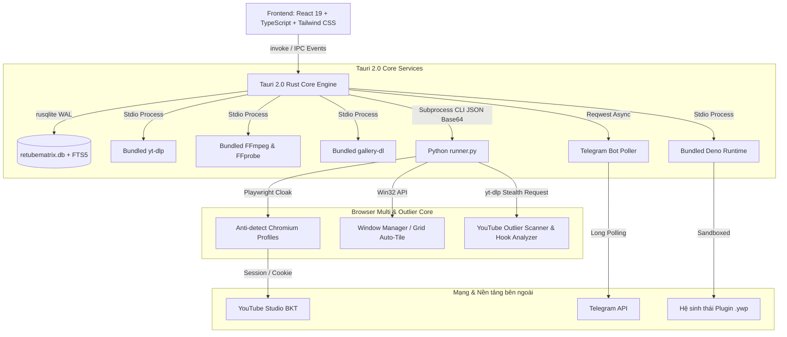
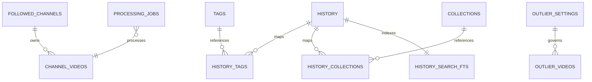
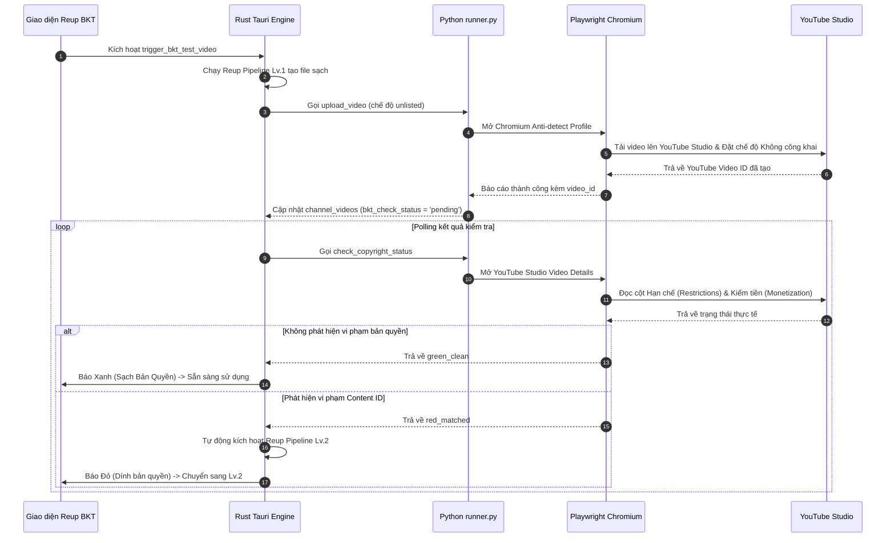
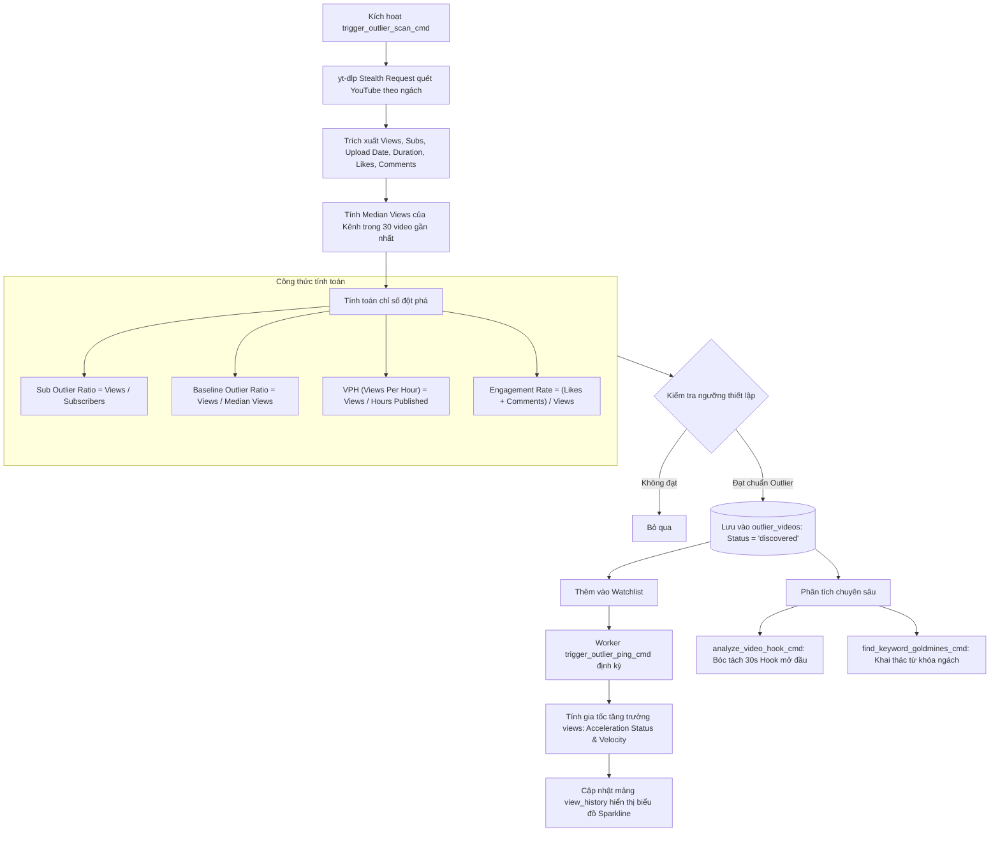

# PROJECT CONTEXT — RETUBEMATRIX

> **Tệp quy chuẩn bối cảnh dự án (Project Context)**
> Khi bắt đầu phiên làm việc mới với AI, chỉ cần chỉ định:
> _"Hãy đọc tệp `PROJECT_CONTEXT.md` để nắm toàn bộ bối cảnh dự án trước khi chúng ta bắt đầu."_

---

## 1. TỔNG QUAN DỰ ÁN & MỤC ĐÍCH

- **Tên ứng dụng**: **RETubeMatrix** (Tên mã kỹ thuật: `reupytb`, Tên gói: `retubematrix`)
- **Phiên bản hiện tại**: `v0.20.16` (Phát hành: 2026-11-06)
- **Mục đích**: Nền tảng Desktop All-in-One chuyên nghiệp dành cho việc săn đón video đề xuất ngách (Outlier Hunter theo mô hình Ikigai), tải video sạch đa luồng, theo dõi tự động kênh đối thủ (đối chiếu 1-1 không nhầm lẫn kênh), xử lý lách bản quyền đa cấp độ (Reup Pipeline Lv.1 & Lv.2 đổi Checksum MD5/SHA256, Dynamic Audio Resampling, xóa sạch EXIF gốc), kiểm tra bản quyền trực tiếp với YouTube Studio qua Kênh Test BKT độc lập (Quota 15 video/24h, Traffic Light Xanh/Vàng/Đỏ), AI tối ưu Tiêu đề (Quy tắc 95%-5%) & Thumbnail (bảo toàn 95% nhân vật/chữ), quản lý hồ sơ trình duyệt Anti-Detect độc lập (MultiBrowser Cloak Chromium 155), chẩn đoán lỗi chuyên biệt 6 file log và hệ sinh thái Plugin mở rộng (`.ywp`).

- **Công nghệ cốt lõi (Tech Stack)**:
  - **Desktop Core**: [Tauri 2.0](https://tauri.app/) (Rust backend)
  - **Frontend**: React 19 + TypeScript + Tailwind CSS + Radix UI + Lucide Icons + Vite
  - **Database**: SQLite (`rusqlite`) ở chế độ WAL Mode kết hợp Virtual Table FTS5 tìm kiếm toàn văn bản tiếng Việt không dấu (`unicode61 remove_diacritics 2`)
  - **External Bundled Engines**: Bundled `yt-dlp`, Bundled `FFmpeg`/`FFprobe`, Bundled `gallery-dl`, Bundled `Deno runtime`, Bundled `Python 3 Embed`
  - **Browser Automation Core**: Python 3 (Playwright / Chromium Cloak Engine) cô lập tại `%LOCALAPPDATA%\reupytb\browser_engine\`
  - **Plugin Engine**: Kiến trúc sandbox chạy các gói `.ywp` có chữ ký, hỗ trợ JavaScript/TypeScript SDK (`retubematrix-sdk`) chạy trên Deno hoặc Node.js runtime

- **Môi trường & Công cụ phát triển**:
  - Package manager: `bun` (tuyệt đối không dùng npm/npx theo quy chuẩn `AGENTS.md`)
  - Linting: `bun run biome check --write .`
  - Rust check: `cargo check` (trong thư mục `src-tauri/`)
  - TypeScript check: `bun run tsc -b`
  - Chạy dev: `bun run tauri dev`

---

## 2. KIẾN TRÚC TỔNG THỂ & IPC CONTRACT

Ứng dụng hoạt động theo mô hình Hybrid đa tiến trình an toàn và độc lập:



---

## 3. DOCS CHO BACKEND & API

### 3.1. Rust Tauri IPC Commands (`src-tauri/src/commands/`)

Tất cả các command được đăng ký trong `src-tauri/src/lib.rs` và giao tiếp với Frontend qua `@tauri-apps/api/core::invoke`. Tham số từ Frontend luôn tuân thủ quy ước `camelCase` (kèm dự phòng `snake_case` ở backend).

#### A. Download & Queue Commands (`commands/download.rs`, `commands/download_queue.rs`)

| Command Name           | Tham số                               | Ý nghĩa                                                                                                           |
| :--------------------- | :------------------------------------ | :---------------------------------------------------------------------------------------------------------------- |
| `download_video`       | `url`, `quality`, `format`, `options` | Bắt đầu tải video/audio với yt-dlp (hỗ trợ proxy, cookie, cắt đoạn time range, sponsorblock, subtitles, playlist) |
| `stop_download`        | `id`                                  | Hủy tiến trình tải video cụ thể                                                                                   |
| `load_download_queue`  | `queue_kind`                          | Nạp danh sách hàng đợi đã lưu từ SQLite (`download_queues`)                                                       |
| `save_download_queue`  | `queue_kind`, `items_json`            | Lưu trạng thái hàng đợi tải xuống SQLite khi tắt app                                                              |
| `clear_download_queue` | `queue_kind`                          | Xóa sạch hàng đợi tải tương ứng                                                                                   |

#### B. Gallery & Media Split Commands (`commands/gallery.rs`, `commands/media_split.rs`)

| Command Name            | Tham số                                | Ý nghĩa                                                                                |
| :---------------------- | :------------------------------------- | :------------------------------------------------------------------------------------- |
| `download_gallery`      | `url`, `options`                       | Tải album/gallery ảnh hoặc đa phương tiện bằng `gallery-dl`                            |
| `stop_gallery_download` | `id`                                   | Hủy tiến trình tải gallery                                                             |
| `check_gallerydl`       | -                                      | Kiểm tra runtime và binary `gallery-dl`                                                |
| `split_media_segments`  | `input_path`, `segments`, `output_dir` | Cắt nhỏ video/audio thành nhiều phân đoạn không mã hóa lại hoặc với FFmpeg stream copy |

#### C. Video Info & Subtitle Detection (`commands/video.rs`, `commands/youtube_search.rs`)

| Command Name              | Tham số          | Ý nghĩa                                                                  |
| :------------------------ | :--------------- | :----------------------------------------------------------------------- |
| `get_video_basic_info`    | `url`            | Lấy nhanh tiêu đề, thumbnail, thời lượng video                           |
| `get_video_info`          | `url`, `cookies` | Trích xuất toàn bộ metadata chi tiết, danh sách formats và audio streams |
| `get_playlist_entries`    | `url`            | Trích xuất danh sách tất cả video trong một playlist YouTube             |
| `search_youtube_videos`   | `query`, `limit` | Tìm kiếm video YouTube trực tiếp                                         |
| `get_available_subtitles` | `url`            | Lấy danh sách phụ đề có sẵn (gốc & tự động tạo)                          |
| `get_video_transcript`    | `url`, `lang`    | Bóc tách nội dung phụ đề/transcript của video                            |

#### D. Channel Monitoring & Polling Commands (`commands/channels.rs`)

| Command Name                                  | Tham số                                         | Ý nghĩa                                                                                             |
| :-------------------------------------------- | :---------------------------------------------- | :-------------------------------------------------------------------------------------------------- |
| `get_followed_channels`                       | -                                               | Lấy danh sách toàn bộ kênh đang theo dõi kèm cấu hình lọc                                           |
| `follow_channel`                              | `url`, `config`                                 | Theo dõi kênh mới, tự động resolve `youtube_channel_id` để kích hoạt RSS siêu tốc                   |
| `unfollow_channel`                            | `id`                                            | Hủy theo dõi kênh và xóa dữ liệu liên quan                                                          |
| `update_channel_settings`                     | `id`, `settings`                                | Cập nhật cấu hình lọc (duration, include/exclude keywords, threads, codec, Reup pipeline, template) |
| `update_channel_info`                         | `id`, `name`, `thumbnail`                       | Cập nhật tên hoặc ảnh đại diện kênh                                                                 |
| `check_channel_now`                           | `channel_id`                                    | Kích hoạt quét video mới ngay lập tức (bỏ qua chu kỳ hẹn giờ)                                       |
| `toggle_channel_auto_download`                | `channel_id`, `enabled`                         | Bật/tắt tự động tải video mới khi quét thấy                                                         |
| `get_channel_videos`                          | `channel_id`, `status`, `page`, `limit`         | Lấy danh sách video quét được từ kênh                                                               |
| `save_channel_videos`                         | `videos`                                        | Lưu danh sách video quét được vào bảng `channel_videos`                                             |
| `get_saved_channel_videos`                    | `channel_id`                                    | Lấy toàn bộ video đã lưu của kênh                                                                   |
| `get_saved_channel_videos_by_video_ids`       | `video_ids`                                     | Truy vấn video theo danh sách ID                                                                    |
| `update_channel_video_status`                 | `id`, `status`                                  | Đổi trạng thái video (`new`, `downloading`, `downloaded`, `failed`, `ignored`)                      |
| `update_channel_video_status_by_video_id`     | `channel_id`, `video_id`, `status`              | Cập nhật trạng thái theo cặp channel_id + video_id                                                  |
| `get_new_videos_count`                        | -                                               | Lấy tổng số video mới chưa xử lý                                                                    |
| `get_channel_stats` / `get_all_channel_stats` | `channel_id` / -                                | Thống kê số lượng video, trạng thái tải của từng kênh hoặc toàn bộ                                  |
| `set_polling_network_config`                  | `proxy`, `rate_limit`                           | Cài đặt thông số mạng, proxy cho worker polling                                                     |
| `update_channel_bkt_config`                   | `channel_id`, `bkt_test_mode`, `bkt_profile_id` | Cấu hình chế độ kiểm tra bản quyền BKT và chọn profile YouTube Studio                               |
| `trigger_bkt_test_video`                      | `channel_video_id`, `profile_id`                | Đẩy video kênh nghi vấn lên YouTube Studio ở chế độ unlisted để test bản quyền                      |
| `check_bkt_copyright_status_cmd`              | `profile_id`, `video_id`                        | Quét YouTube Studio kiểm tra kết quả Content ID của video                                           |

#### E. Outlier Hunter Commands (`commands/outliers.rs`)

| Command Name                      | Tham số                                                         | Ý nghĩa                                                                                           |
| :-------------------------------- | :-------------------------------------------------------------- | :------------------------------------------------------------------------------------------------ |
| `get_outlier_settings_cmd`        | -                                                               | Đọc cấu hình Outlier Hunter (danh sách ngách, ngưỡng views, max subs, min outlier ratio, min VPH) |
| `update_outlier_settings_cmd`     | `settings`                                                      | Cập nhật cấu hình bộ lọc Outlier Hunter                                                           |
| `get_outlier_videos_cmd`          | `status`, `niche`, `limit`                                      | Truy vấn danh sách video đột phá theo ngách và trạng thái                                         |
| `update_outlier_video_status_cmd` | `id`, `status`, `local_filepath`, `reup_filepath`, `bkt_status` | Cập nhật trạng thái video (`discovered`, `watchlist`, `downloaded`, `reuped`, `ignored`)          |
| `delete_outlier_video_cmd`        | `id`                                                            | Xóa video khỏi danh sách Outlier                                                                  |
| `trigger_outlier_scan_cmd`        | `niche`                                                         | Kích hoạt worker quét YouTube tìm các video vượt trội theo ngách                                  |
| `trigger_outlier_ping_cmd`        | -                                                               | Ping lại danh sách Watchlist để tính tốc độ gia tốc views (Momentum / Acceleration)               |
| `find_keyword_goldmines_cmd`      | `seed_keyword`                                                  | Khai thác từ khóa vàng dựa trên YouTube Autocomplete & độ cạnh tranh                              |
| `analyze_video_hook_cmd`          | `video_id`                                                      | Phân tích 30 giây đầu kịch bản hook transcript của video triệu views                              |

#### F. Reup Pipeline & Video Processing Commands (`commands/processing.rs`, `commands/processing/*`)

| Command Name                                                                     | Tham số                     | Ý nghĩa                                                                                                                                                              |
| :------------------------------------------------------------------------------- | :-------------------------- | :------------------------------------------------------------------------------------------------------------------------------------------------------------------- |
| `run_reup_pipeline_v1_cmd`                                                       | `input_path`, `output_path` | Chạy Reup Pipeline Cấp độ 1 (giữ 95% gốc, scale/crop 1.01x, speed 1.03x, pitch 1.02x, dynamic resampling, clear EXIF, 32 bytes padding đổi MD5)                      |
| `run_reup_pipeline_v2_cmd`                                                       | `input_path`, `output_path` | Chạy Reup Pipeline Cấp độ 2 (Lách sâu: hflip, cân bằng màu LUT, scale 1.02x, crop 2%, speed 1.05x, pitch 1.04x, dynamic resampling, 48 bytes padding đổi MD5/SHA256) |
| `get_video_metadata`                                                             | `path`                      | Trích xuất thông số kỹ thuật video (codec, resolution, fps, bitrate, audio sample rate) bằng `ffprobe`                                                               |
| `detect_shot_changes`                                                            | `video_path`, `threshold`   | Nhận diện điểm chuyển cảnh (Scene Cut detection) hỗ trợ làm phụ đề và cắt dựng                                                                                       |
| `get_image_metadata`                                                             | `path`                      | Đọc thông số metadata ảnh                                                                                                                                            |
| `get_processing_attachment_info`                                                 | `path`                      | Lấy thông tin file đính kèm/media đầu vào                                                                                                                            |
| `generate_processing_command`                                                    | `params`                    | Tạo chuỗi câu lệnh FFmpeg tùy chỉnh theo yêu cầu người dùng                                                                                                          |
| `generate_quick_action_command`                                                  | `action`, `input_path`      | Tạo nhanh lệnh FFmpeg (nén video, chuyển MP4, trích âm thanh, lật hình)                                                                                              |
| `execute_ffmpeg_command`                                                         | `command`, `job_id`         | Thực thi lệnh FFmpeg với thanh tiến trình realtime                                                                                                                   |
| `cancel_ffmpeg`                                                                  | `job_id`                    | Hủy lệnh FFmpeg đang thực thi                                                                                                                                        |
| `get_processing_history` / `clear_processing_history`                            | -                           | Quản lý lịch sử xử lý video trong SQLite (`processing_jobs`)                                                                                                         |
| `save_processing_job` / `update_processing_job` / `delete_processing_job`        | `job` / `id`                | CRUD tác vụ xử lý video                                                                                                                                              |
| `get_processing_presets` / `save_processing_preset` / `delete_processing_preset` | `preset` / `id`             | Quản lý mẫu xử lý video FFmpeg định sẵn                                                                                                                              |
| `generate_video_preview` / `generate_audio_preview` / `generate_video_thumbnail` | `params`                    | Tạo file preview nhanh để xem trước hiệu ứng                                                                                                                         |
| `cleanup_previews`                                                               | -                           | Dọn dẹp cache preview tạm thời                                                                                                                                       |

#### G. MultiBrowser Profiles & YouTube Studio Automation Commands (`commands/profiles.rs`)

| Command Name                       | Tham số                               | Ý nghĩa                                                                                                              |
| :--------------------------------- | :------------------------------------ | :------------------------------------------------------------------------------------------------------------------- |
| `get_multibrowser_profiles`        | -                                     | Lấy danh sách toàn bộ hồ sơ trình duyệt từ kho `%LOCALAPPDATA%\reupytb\browser_engine\profiles\`                     |
| `save_multibrowser_profile`        | `profile`                             | Tạo mới hoặc cập nhật hồ sơ (Name, Group, Proxy, Note, Tags, Color)                                                  |
| `delete_multibrowser_profile`      | `profile_id`                          | Xóa hồ sơ và giải phóng thư mục dữ liệu kèm SingletonLock                                                            |
| `launch_multibrowser_profile`      | `profile_id`                          | Mở trình duyệt anti-detect Chromium với fingerprint cô lập                                                           |
| `stop_multibrowser_profile`        | `profile_id`                          | Đóng trình duyệt profile cụ thể                                                                                      |
| `bulk_stop_multibrowser_profiles`  | `profile_ids`                         | Đóng hàng loạt trình duyệt đang mở                                                                                   |
| `test_multibrowser_proxy`          | `proxy`                               | Kiểm tra độ trễ (latency ms), IP thực và quốc gia (Geo Location) của proxy                                           |
| `get_multibrowser_stats`           | -                                     | Lấy thống kê Dashboard: số profile sẵn sàng, đang chạy, lỗi hôm nay, runtime, phiên chạy gần đây                     |
| `arrange_multibrowser_windows`     | `params`                              | Tự động sắp xếp các cửa sổ Chromium theo dạng lưới (Auto-fit, Tile, Cascade, 2-3-4 cột) trên màn hình bằng Win32 API |
| `clean_multibrowser_profile_cache` | `profile_id`                          | Dọn dẹp cache trình duyệt an toàn (xóa cache GPU/Code, giữ nguyên Cookie đăng nhập)                                  |
| `update_multibrowser_profile_meta` | `profile_id`, `note`, `tags`, `color` | Cập nhật nhãn và ghi chú nhanh                                                                                       |
| `bulk_set_multibrowser_group`      | `profile_ids`, `group`                | Gom nhóm hàng loạt hồ sơ trình duyệt                                                                                 |
| `upload_video_multibrowser`        | `params`                              | Tự động đăng tải video lên YouTube Studio (điền tiêu đề, mô tả, tags, thumbnail, visibility, đặt lịch)               |

#### H. AI & Whisper Commands (`commands/ai.rs`, `commands/whisper.rs`)

| Command Name                                               | Tham số                           | Ý nghĩa                                                                    |
| :--------------------------------------------------------- | :-------------------------------- | :------------------------------------------------------------------------- |
| `save_ai_config` / `get_ai_config`                         | `config` / -                      | Lưu/đọc cấu hình AI (OpenAI, Gemini, Claude, Ollama, Custom URL, API Keys) |
| `test_ai_connection`                                       | `config`                          | Kiểm tra kết nối tới nhà cung cấp AI                                       |
| `generate_video_summary` / `generate_summary_with_options` | `url` / `text`, `config`          | Tóm tắt video/transcript với streaming SSE                                 |
| `cancel_summary_generation`                                | `request_id`                      | Hủy tiến trình AI đang tóm tắt                                             |
| `generate_ai_response`                                     | `prompt`, `system_prompt`         | Gửi prompt tùy ý tới mô hình AI                                            |
| `get_ai_models`                                            | `provider`                        | Lấy danh sách model được hỗ trợ                                            |
| `get_summary_languages`                                    | -                                 | Danh sách ngôn ngữ tóm tắt                                                 |
| `transcribe_video_with_whisper`                            | `video_path`, `format`, `api_key` | Trích xuất âm thanh và phiên âm video thành phụ đề SRT/VTT bằng Whisper    |
| `transcribe_url_with_whisper`                              | `url`, `format`, `api_key`        | Tải audio nhẹ nhất và phiên âm phụ đề từ URL                               |
| `generate_subtitles_with_whisper`                          | `params`                          | Tạo phụ đề chi tiết có mốc thời gian chính xác                             |

#### I. Plugin System Commands (`commands/plugin.rs`)

| Command Name                                                     | Tham số                    | Ý nghĩa                                                                                       |
| :--------------------------------------------------------------- | :------------------------- | :-------------------------------------------------------------------------------------------- |
| `list_plugins`                                                   | -                          | Liệt kê tất cả plugin đã cài đặt                                                              |
| `get_plugin_details`                                             | `plugin_id`                | Xem chi tiết manifest, quyền hạn, cấu hình và trạng thái của plugin                           |
| `inspect_plugin_package`                                         | `package_path`             | Kiểm tra gói `.ywp` trước khi cài đặt (xác minh chữ ký và quyền hạn)                          |
| `install_plugin_package`                                         | `package_path`             | Cài đặt gói plugin `.ywp` vào hệ thống                                                        |
| `uninstall_plugin`                                               | `plugin_id`                | Gỡ bỏ plugin khỏi ứng dụng                                                                    |
| `update_plugin_state`                                            | `plugin_id`, `enabled`     | Bật/tắt plugin                                                                                |
| `get_plugin_trigger_workflow` / `update_plugin_trigger_workflow` | `trigger` / `config`       | Quản lý quy trình tự động hóa workflow theo sự kiện (`download.completed`, `download.failed`) |
| `enqueue_plugin_workflow_trigger`                                | `trigger`, `payload`       | Kích hoạt thủ công một trigger workflow                                                       |
| `approve_plugin_permissions`                                     | `plugin_id`, `permissions` | Cấp phép các quyền mà plugin yêu cầu (network, filesystem, notifications)                     |
| `update_plugin_config_values`                                    | `plugin_id`, `values`      | Cập nhật giá trị cấu hình riêng của plugin                                                    |
| `set_plugin_provider` / `set_plugin_timeout`                     | `params`                   | Đổi runtime provider (Deno/Node) và thời gian chờ tối đa                                      |
| `open_plugin_directory`                                          | `plugin_id`                | Mở thư mục chứa mã nguồn plugin trên máy                                                      |
| `list_runtime_providers` / `get_runtime_provider_status`         | -                          | Kiểm tra tính sẵn sàng của các runtime Deno / Node.js                                         |
| `get_plugin_logs` / `clear_plugin_logs`                          | `plugin_id`                | Xem hoặc xóa nhật ký thực thi của plugin                                                      |

#### J. Telegram Remote Commands (`commands/telegram.rs`)

| Command Name          | Tham số                  | Ý nghĩa                                                                                       |
| :-------------------- | :----------------------- | :-------------------------------------------------------------------------------------------- |
| `set_telegram_config` | `config: TelegramConfig` | Cấu hình Bot Token, danh sách Chat ID cho phép, và hành động mặc định (`Add` hoặc `Download`) |
| `get_telegram_status` | -                        | Lấy trạng thái kết nối bot Telegram (`Running`, `Disabled`, `Error`)                          |
| `send_telegram_reply` | `chat_id`, `message`     | Gửi tin nhắn phản hồi về Telegram                                                             |

#### K. History, Tags & Collections Commands (`commands/history.rs`)

| Command Name                                                                        | Tham số                            | Ý nghĩa                                                             |
| :---------------------------------------------------------------------------------- | :--------------------------------- | :------------------------------------------------------------------ |
| `add_history`                                                                       | `entry`                            | Ghi nhận video đã tải vào lịch sử                                   |
| `get_history`                                                                       | `query`, `limit`, `offset`         | Truy vấn lịch sử (tự động sử dụng FTS5 nếu có chuỗi tìm kiếm)       |
| `get_history_entries_by_ids`                                                        | `ids`                              | Lấy chi tiết các mục lịch sử theo danh sách ID                      |
| `find_duplicate_downloads`                                                          | `url`, `media_id`, `canonical_url` | Phát hiện video đã tải trước đó để tránh tải trùng lặp              |
| `delete_history` / `clear_history`                                                  | `id` / -                           | Xóa một mục hoặc toàn bộ lịch sử tải                                |
| `get_history_count`                                                                 | -                                  | Lấy tổng số lượng video trong thư viện                              |
| `get_tags` / `assign_history_tags` / `remove_history_tag`                           | `params`                           | Quản lý nhãn dán cho video trong thư viện                           |
| `get_collections` / `create_collection` / `rename_collection` / `delete_collection` | `params`                           | Quản lý bộ sưu tập video                                            |
| `assign_history_collections` / `remove_history_from_collection`                     | `params`                           | Gán hoặc gỡ video khỏi bộ sưu tập                                   |
| `open_file_location` / `check_file_exists`                                          | `filepath`                         | Mở thư mục chứa file tải hoặc kiểm tra file còn tồn tại trên ổ cứng |
| `rename_downloaded_file` / `sync_history_renamed_entry`                             | `old_path`, `new_name`             | Đổi tên file vật lý và đồng bộ đường dẫn mới trong SQLite           |

#### L. Dependencies Manager Commands (`commands/dependencies.rs`)

| Command Name                                                                           | Tham số       | Ý nghĩa                                                                    |
| :------------------------------------------------------------------------------------- | :------------ | :------------------------------------------------------------------------- |
| `get_ytdlp_version` / `check_ytdlp_update` / `update_ytdlp`                            | -             | Kiểm tra phiên bản, tìm bản cập nhật và nâng cấp `yt-dlp`                  |
| `get_ytdlp_channel_cmd` / `set_ytdlp_channel_cmd`                                      | - / `channel` | Đổi kênh cập nhật yt-dlp (`stable`, `nightly`, `master`)                   |
| `get_ytdlp_source_cmd` / `set_ytdlp_source_cmd`                                        | - / `source`  | Đổi nguồn tải yt-dlp (`bundled` hoặc `system`)                             |
| `check_ffmpeg` / `download_ffmpeg` / `get_ffmpeg_source_cmd` / `set_ffmpeg_source_cmd` | -             | Quản lý nhị phân FFmpeg/FFprobe bundled                                    |
| `check_deno` / `download_deno`                                                         | -             | Quản lý runtime Deno cho Plugin engine                                     |
| `detect_installed_browsers` / `get_browser_profiles`                                   | -             | Phát hiện các trình duyệt và profile cục bộ (Chrome, Edge, Firefox, Brave) |

#### M. CLI, Deep-Link & System Commands

| Command Name                                       | Tham số  | Ý nghĩa                                                            |
| :------------------------------------------------- | :------- | :----------------------------------------------------------------- |
| `get_cli_shortcut_status` / `install_cli_shortcut` | -        | Quản lý shim dòng lệnh `retubematrix` trong WindowsApps / PATH     |
| `consume_pending_external_links`                   | -        | Xử lý các link được mở từ ngoài (Deep link `retubematrix://`)      |
| `consume_pending_cli_download_requests`            | -        | Xử lý yêu cầu tải nhận từ CLI command line                         |
| `bring_main_window_to_front`                       | -        | Đưa cửa sổ ứng dụng lên trên cùng khi người dùng tương tác         |
| `set_hide_dock_on_close`                           | `hide`   | Cấu hình ẩn cửa sổ vào khay hệ thống (Tray) thay vì thoát ứng dụng |
| `rebuild_tray_menu_cmd`                            | `lang`   | Dựng lại menu Khay hệ thống theo ngôn ngữ hiện tại                 |
| `update_tray_download_status`                      | `status` | Cập nhật số lượng download đang chạy lên Khay hệ thống             |

---

### 3.2. Python Browser Engine CLI Actions (`browser_engine/runner.py`)

Giao tiếp qua tiến trình độc lập với mã hóa UTF-8 chuẩn (`python -X utf8 browser_engine/runner.py --action <action> [--profile-id <id>] [--data-b64 <base64>]`).

| Action Name              | Tham số dữ liệu Base64                | Mô tả chi tiết chức năng                                                                                                                                            |
| :----------------------- | :------------------------------------ | :------------------------------------------------------------------------------------------------------------------------------------------------------------------ |
| `list_profiles`          | -                                     | Quét và trả về danh sách toàn bộ hồ sơ trong kho `%LOCALAPPDATA%\reupytb\browser_engine\profiles\`                                                                  |
| `add_profile`            | `profile_data`                        | Tạo hồ sơ mới, sinh seed fingerprint độc lập (Canvas, WebGL, Audio, Hardware Concurrency)                                                                           |
| `update_profile`         | `profile_data`                        | Cập nhật cấu hình hồ sơ (Proxy, user agent, viewport)                                                                                                               |
| `delete_profile`         | `profile_id`                          | Xóa dữ liệu hồ sơ và dọn dẹp các tệp lock                                                                                                                           |
| `test_proxy`             | `proxy_url`                           | Đo latency thực tế (ms), kiểm tra IP public và vị trí địa lý thông qua IP-API                                                                                       |
| `open_profile`           | `profile_id`                          | Khởi động phiên Playwright `CloakSession` với fingerprint chống phát hiện, inject cookies                                                                           |
| `stop_profile`           | `profile_id`                          | Đóng phiên làm việc của hồ sơ và thu hồi tiến trình Chrome                                                                                                          |
| `bulk_stop`              | `profile_ids`                         | Đóng đồng loạt danh sách hồ sơ                                                                                                                                      |
| `upload_video`           | `MultiBrowserUploadParams`            | Tự động hóa đăng video lên YouTube Studio: chọn tệp, điền tiêu đề/mô tả, tải thumbnail, đặt thẻ tags, chọn chế độ hiển thị hoặc lên lịch đăng                       |
| `check_copyright_status` | `profile_id`, `video_id`              | Shadow Check trên YouTube Studio: truy cập trình quản lý video, đọc cột Hạn chế (Restrictions) và Bản quyền (Content ID) -> trả về `green_clean` hoặc `red_matched` |
| `get_stats`              | -                                     | Tổng hợp thống kê thời gian chạy, phiên hoạt động từ `run_history.jsonl` và trạng thái PID                                                                          |
| `arrange_windows`        | `mode`, `cols`, `margin`              | Sử dụng Windows API (`EnumWindows`, `SetWindowPos`) để tự động xếp các cửa sổ Chromium theo lưới màn hình                                                           |
| `clean_cache`            | `profile_id`                          | Dọn dẹp an toàn các thư mục `Cache`, `Code Cache`, `GPUCache`, giữ nguyên Session Cookies                                                                           |
| `update_profile_meta`    | `profile_id`, `note`, `tags`, `color` | Cập nhật nhãn dán, màu đại diện và ghi chú                                                                                                                          |
| `bulk_set_group`         | `profile_ids`, `group`                | Gom nhóm danh sách hồ sơ                                                                                                                                            |
| `hunt_outliers`          | `settings`, `target_niche`            | Quét YouTube bằng yt-dlp trích xuất video theo ngách, tính median views kênh, đo tỷ lệ Outlier Ratio ($Views / Subs$ và $Views / Median$), lọc theo VPH             |
| `ping_momentum`          | `watchlist_videos`                    | Quét lại lượt xem hiện tại của các video trong danh sách theo dõi, đo gia tốc tăng trưởng views/giờ (Acceleration) và cập nhật Sparkline history                    |
| `find_goldmines`         | `seed_keyword`                        | Khai thác từ khóa vàng: gửi truy vấn gợi ý tự động (YouTube Autocomplete API) kết hợp phân tích khối lượng tìm kiếm và độ cạnh tranh ngách                          |
| `analyze_hook`           | `video_id`                            | Bóc tách transcript 30 giây đầu của video triệu view, nhận diện cấu trúc hook mở đầu và các luận điểm chính                                                         |

---

## 4. DOCS CHO DATABASE SCHEMA (SQLite `retubematrix.db`)

Dữ liệu cục bộ được lưu trữ tại `%APPDATA%\com.retubematrix.app\retubematrix.db`.
Hệ thống tự động thực hiện migration an toàn từ file di sản `logs.db` sang `retubematrix.db` (dùng `VACUUM INTO` và `PRAGMA quick_check`).



### 4.1. Bảng `history` (Lịch sử tải & Thư viện video)

Lưu trữ toàn bộ video đã tải thành công, là nguồn căn cứ phát hiện video trùng lặp:
```sql
CREATE TABLE history (
    id TEXT PRIMARY KEY,
    url TEXT NOT NULL,
    title TEXT NOT NULL,
    thumbnail TEXT,
    filepath TEXT NOT NULL,
    filesize INTEGER,
    duration INTEGER,
    quality TEXT,
    format TEXT,
    source TEXT,
    downloaded_at INTEGER NOT NULL,
    summary TEXT,
    time_range TEXT,
    media_id TEXT,
    canonical_url TEXT
);
CREATE INDEX idx_history_downloaded ON history(downloaded_at DESC);
CREATE INDEX idx_history_source ON history(source);
CREATE INDEX idx_history_media_id ON history(media_id);
CREATE INDEX idx_history_canonical_url ON history(canonical_url);
```

### 4.2. Bảng `history_search_fts` (Virtual Table FTS5)

Tìm kiếm toàn văn bản siêu tốc bỏ dấu tiếng Việt, tự động đồng bộ qua Triggers:
```sql
CREATE VIRTUAL TABLE history_search_fts USING fts5(
    history_id UNINDEXED,
    title,
    filepath,
    url,
    summary,
    tokenize = 'unicode61 remove_diacritics 2'
);
```

### 4.3. Bảng `followed_channels` (Theo dõi kênh đối thủ)

```sql
CREATE TABLE followed_channels (
    id TEXT PRIMARY KEY,
    url TEXT NOT NULL UNIQUE,
    name TEXT NOT NULL,
    thumbnail TEXT,
    platform TEXT NOT NULL DEFAULT 'youtube',
    last_checked_at TEXT,
    last_video_id TEXT,
    check_interval INTEGER NOT NULL DEFAULT 15,
    auto_download INTEGER NOT NULL DEFAULT 0,
    download_quality TEXT NOT NULL DEFAULT 'best',
    download_format TEXT NOT NULL DEFAULT 'mp4',
    download_threads INTEGER NOT NULL DEFAULT 1,
    download_video_codec TEXT NOT NULL DEFAULT 'h264',
    download_audio_bitrate TEXT NOT NULL DEFAULT '192',
    download_preferred_fps TEXT NOT NULL DEFAULT 'original',
    youtube_content_type TEXT NOT NULL DEFAULT 'all', -- 'all' | 'videos' | 'shorts' | 'streams'
    youtube_channel_id TEXT, -- Cho phép RSS Polling tức thời
    total_videos INTEGER,
    filter_min_duration INTEGER,
    filter_max_duration INTEGER,
    filter_include_keywords TEXT,
    filter_exclude_keywords TEXT,
    filter_max_videos INTEGER,
    reup_mod_enabled INTEGER DEFAULT 0,
    reup_mod_speed REAL DEFAULT 1.03,
    reup_mod_pitch REAL DEFAULT 1.02,
    reup_mod_flip INTEGER DEFAULT 0,
    reup_mod_crop REAL DEFAULT 0.015,
    custom_filename_template TEXT,
    risk_status TEXT DEFAULT 'green', -- 'green' | 'yellow' | 'red'
    risk_reason TEXT,
    bkt_test_mode INTEGER DEFAULT 0,
    bkt_profile_id TEXT,
    created_at TEXT NOT NULL
);
```

### 4.4. Bảng `channel_videos` (Video quét từ kênh đối thủ)

```sql
CREATE TABLE channel_videos (
    id TEXT PRIMARY KEY,
    channel_id TEXT NOT NULL,
    video_id TEXT NOT NULL,
    title TEXT NOT NULL,
    url TEXT NOT NULL,
    thumbnail TEXT,
    duration REAL,
    upload_date TEXT,
    upload_timestamp INTEGER,
    video_type TEXT DEFAULT 'video', -- 'video' | 'short' | 'stream'
    view_count INTEGER,
    status TEXT NOT NULL DEFAULT 'new', -- 'new' | 'downloading' | 'downloaded' | 'failed' | 'ignored'
    risk_status TEXT DEFAULT 'green',
    risk_reason TEXT,
    is_bkt_test INTEGER DEFAULT 0,
    bkt_youtube_id TEXT,
    bkt_check_status TEXT, -- 'pending' | 'green_clean' | 'red_matched' | 'failed'
    bkt_restriction TEXT,
    reup_pipeline_level INTEGER DEFAULT 1,
    created_at TEXT NOT NULL,
    FOREIGN KEY (channel_id) REFERENCES followed_channels(id) ON DELETE CASCADE,
    UNIQUE(channel_id, video_id)
);
CREATE INDEX idx_channel_videos_channel ON channel_videos(channel_id);
CREATE INDEX idx_channel_videos_status ON channel_videos(status);
```

### 4.4B. Bảng `bkt_test_channels` & `bkt_test_jobs` (Kênh Test Bản Quyền Pool)

Quản lý hạn ngạch độc lập (Quota 15 video/24h) và hàng đợi điều phối test bản quyền:
```sql
CREATE TABLE bkt_test_channels (
    id TEXT PRIMARY KEY,
    name TEXT NOT NULL,
    profile_id TEXT NOT NULL,
    youtube_channel_name TEXT,
    youtube_channel_id TEXT,
    daily_quota INTEGER NOT NULL DEFAULT 15,
    daily_used INTEGER NOT NULL DEFAULT 0,
    last_reset_date TEXT NOT NULL, -- 'YYYY-MM-DD'
    is_active INTEGER NOT NULL DEFAULT 1,
    priority INTEGER NOT NULL DEFAULT 0,
    note TEXT,
    created_at TEXT NOT NULL,
    updated_at TEXT NOT NULL
);

CREATE TABLE bkt_test_jobs (
    id TEXT PRIMARY KEY,
    video_id TEXT NOT NULL,
    video_title TEXT,
    video_file_path TEXT NOT NULL,
    source_channel_id TEXT,
    test_channel_id TEXT,
    profile_id TEXT,
    status TEXT NOT NULL DEFAULT 'pending', -- 'pending' | 'uploading' | 'checking' | 'completed' | 'failed'
    bkt_check_status TEXT, -- 'green_clean' | 'red_matched' | 'failed'
    bkt_youtube_id TEXT,
    bkt_restriction TEXT,
    error_message TEXT,
    created_at TEXT NOT NULL,
    updated_at TEXT NOT NULL
);
CREATE INDEX idx_bkt_jobs_status ON bkt_test_jobs(status);
CREATE INDEX idx_bkt_jobs_channel ON bkt_test_jobs(test_channel_id);
```

### 4.5. Bảng `outlier_hunter_settings` & `outlier_videos` (Thợ săn video đột phá)

```sql
CREATE TABLE outlier_hunter_settings (
    id TEXT PRIMARY KEY DEFAULT 'default',
    enabled INTEGER NOT NULL DEFAULT 1,
    niches TEXT NOT NULL DEFAULT '["review phim","tin tức","công nghệ","giải trí"]',
    min_views INTEGER NOT NULL DEFAULT 25000,
    max_subscribers INTEGER NOT NULL DEFAULT 25000,
    min_sub_outlier REAL NOT NULL DEFAULT 5.0,
    min_baseline_outlier REAL NOT NULL DEFAULT 5.0,
    min_duration INTEGER NOT NULL DEFAULT 180,
    min_vph REAL NOT NULL DEFAULT 300.0,
    min_engagement_rate REAL NOT NULL DEFAULT 0.012,
    min_comments INTEGER NOT NULL DEFAULT 15,
    auto_download INTEGER NOT NULL DEFAULT 0,
    auto_reup_level TEXT NOT NULL DEFAULT 'v1',
    auto_bkt_test INTEGER NOT NULL DEFAULT 0,
    scan_interval_minutes INTEGER NOT NULL DEFAULT 60,
    updated_at TEXT NOT NULL DEFAULT CURRENT_TIMESTAMP
);

CREATE TABLE outlier_videos (
    id TEXT PRIMARY KEY,
    niche TEXT NOT NULL,
    title TEXT NOT NULL,
    thumbnail_url TEXT NOT NULL DEFAULT '',
    channel_id TEXT NOT NULL,
    channel_name TEXT NOT NULL,
    subscribers INTEGER NOT NULL,
    views INTEGER NOT NULL,
    likes INTEGER NOT NULL DEFAULT 0,
    comments INTEGER NOT NULL DEFAULT 0,
    duration INTEGER NOT NULL,
    upload_timestamp INTEGER NOT NULL,
    hours_published REAL NOT NULL,
    avg_vph REAL NOT NULL,
    current_vph REAL,
    momentum_score REAL DEFAULT 1.0,
    sub_outlier_ratio REAL NOT NULL,
    baseline_median_views INTEGER NOT NULL,
    baseline_outlier_ratio REAL NOT NULL,
    engagement_rate REAL NOT NULL,
    view_history TEXT NOT NULL DEFAULT '[]', -- Mảng JSON lưu lịch sử điểm view theo thời gian cho biểu đồ Sparkline
    status TEXT NOT NULL DEFAULT 'discovered', -- 'discovered' | 'watchlist' | 'downloaded' | 'reuped' | 'ignored'
    local_filepath TEXT,
    reup_filepath TEXT,
    bkt_status TEXT DEFAULT 'none',
    opportunity_score REAL DEFAULT 0.0,
    demand_signal TEXT DEFAULT '',
    hook_analysis TEXT DEFAULT '',
    acceleration_status TEXT DEFAULT '',
    view_velocity REAL DEFAULT 0.0,
    created_at TEXT NOT NULL,
    last_ping_at TEXT NOT NULL
);
CREATE INDEX idx_outlier_status ON outlier_videos(status);
CREATE INDEX idx_outlier_momentum ON outlier_videos(momentum_score DESC);
CREATE INDEX idx_outlier_niche ON outlier_videos(niche);
CREATE INDEX idx_outlier_opp ON outlier_videos(opportunity_score DESC);
```

### 4.6. Bảng `processing_jobs` & `processing_presets` (Tiến trình xử lý FFmpeg)

```sql
CREATE TABLE processing_jobs (
    id TEXT PRIMARY KEY,
    input_path TEXT NOT NULL,
    output_path TEXT,
    task_type TEXT NOT NULL,
    user_prompt TEXT,
    ffmpeg_command TEXT NOT NULL,
    status TEXT NOT NULL DEFAULT 'pending',
    progress REAL DEFAULT 0,
    error_message TEXT,
    pipeline_level INTEGER DEFAULT 1,
    risk_status TEXT DEFAULT 'green',
    risk_reason TEXT,
    is_bkt_test INTEGER DEFAULT 0,
    channel_video_id TEXT,
    created_at TEXT NOT NULL,
    completed_at TEXT
);
CREATE INDEX idx_processing_jobs_created ON processing_jobs(created_at DESC);

CREATE TABLE processing_presets (
    id TEXT PRIMARY KEY,
    name TEXT NOT NULL,
    description TEXT,
    task_type TEXT NOT NULL,
    prompt_template TEXT NOT NULL,
    icon TEXT,
    created_at TEXT NOT NULL
);
```

### 4.7. Bảng `download_queues`, `tags`, `collections`, `logs`

- `download_queues`: Lưu trữ danh sách hàng đợi tải (`queue_kind`, `items_json`, `updated_at`).
- `tags` / `history_tags`: Quản lý nhãn dán video (`id`, `name`, `normalized_name`).
- `collections` / `history_collections`: Quản lý nhóm bộ sưu tập (`id`, `name`, `normalized_name`, `color`).
- `logs`: Ghi vết hoạt động tải và hệ thống (`id`, `timestamp`, `log_type`, `message`, `details`, `url`, `created_at`).

---

## 5. DOCS CHO CÁC LUỒNG XỬ LÝ WORKERS & ENGINES

### 5.1. Luồng Reup Pipeline Chống Bản Quyền (`services/ffmpeg.rs`)

Hệ thống triển khai 2 cấp độ Reup xử lý video và âm thanh độc lập nhằm qua mặt thuật toán Content ID:

#### Cấp độ 1: Reup Pipeline Lv.1 (95% Giữ Gốc — 5% Biến Đổi Nhẹ)

- **Video Filter**:
  - `scale=iw*1.01:ih*1.01,crop=iw/1.01:ih/1.01`: Phóng to 1% và cắt biên nhẹ 1% để loại bỏ watermark và viền gốc.
  - `setpts=PTS/1.03`: Tăng tốc độ phát video lên 1.03x.
- **Audio Filter (Dynamic Audio Resampling)**:
  - **Bắt buộc**: Dùng FFprobe trích xuất sample rate thực tế của video nguồn (`{sr}` ví dụ `48000` hoặc `44100` Hz). Tuyệt đối không hardcode `44100`.
  - Bộ lọc: `asetrate={sr}*1.02,aresample={sr},atempo={1.03/1.02}` (tương đương `atempo=1.0098`). Cơ chế này dịch tần số pitch 1.02x, sau đó đưa sample rate về chuẩn gốc của file và điều chỉnh tempo để đồng bộ chính xác từng mili-giây với tốc độ video 1.03x, triệt tiêu hoàn toàn hiện tượng lệch tiếng (audio drift).
- **Metadata Stripping**:
  - `-map_metadata -1 -metadata title="" -metadata artist="" -metadata comment="" -fflags +bitexact`. Xóa toàn bộ dữ liệu máy quay, thời gian tạo gốc, và gán cờ bitexact.
- **Byte Padding (Thay đổi MD5 & SHA256)**:
  - Ghi ngẫu nhiên 32 bytes kết thúc bằng chuỗi `\0REUPYTB_...` vào cuối container file MP4 bằng Rust `OpenOptions::append`. Việc này biến đổi hoàn toàn hash Checksum mà không ảnh hưởng tới khả năng phát của player.

#### Cấp độ 2: Reup Pipeline Lv.2 (Lách Sâu Deep Evasion)

- Tự động kích hoạt khi video bị phát hiện dính bản quyền (`red_matched`) trong quá trình Shadow Check.
- **Video Filter**:
  - `hflip`: Lật ngang toàn bộ khung hình video.
  - `eq=contrast=1.04:brightness=0.02:saturation=1.05`: Hiệu chỉnh màu sắc (tăng nhẹ tương phản, độ sáng và độ bão hòa) để phá vỡ chữ ký màu sắc (Color Histogram signature).
  - `scale=iw*1.02:ih*1.02,crop=iw/1.02:ih/1.02`: Thu phóng 2% và crop 2%.
  - `setpts=PTS/1.05`: Tốc độ 1.05x.
- **Audio Filter**:
  - `asetrate={sr}*1.04,aresample={sr},atempo={1.05/1.04}` (tương đương `atempo=1.009615`).
- **Metadata & Byte Padding**: Xóa sạch metadata và bổ sung 48 bytes random padding.

---

### 5.2. Luồng Kiểm Tra Kênh BKT (Shadow Check) & Tự Động Hóa YouTube Studio



---

### 5.3. Luồng Thợ Săn Video Đột Phá (Outlier Hunter Pipeline)



---

### 5.4. Luồng Điều Khiển Từ Xa Qua Telegram Bot (`services/telegram.rs`)

1. **Khởi tạo kết nối**: Khi cấu hình `bot_token` được bật, worker kích hoạt một async task nền chạy `getUpdates` dạng Long Polling (timeout 30 giây) tới Telegram API.
2. **Kiểm tra quyền truy cập (Access Control)**:
   - Mọi tin nhắn đến đều được kiểm tra `chat_id` dựa trên mảng `allowed_chat_ids`.
   - Nếu `allowed_chat_ids` không rỗng và `chat_id` người gửi không nằm trong danh sách, bot lập tức từ chối và cảnh báo.
3. **Phân tích lệnh (Command Parser)**:
   - `/start` hoặc `/help`: Gửi hướng dẫn cú pháp lệnh.
   - `/download <url> [quality]`: Kích hoạt tải ngay lập tức với chất lượng chỉ định.
   - `/add <url> [quality]`: Thêm video vào hàng đợi tải.
   - Gửi URL trực tiếp: Thực hiện hành động theo cấu hình `plain_url_action` (`Download` hoặc `Add`).
4. **Phản hồi trạng thái**: Gửi thông báo hoàn thành hoặc lỗi về người dùng Telegram kèm dung lượng và thời lượng video.

---

### 5.5. Hệ Sinh Thái Plugin & Workflow Automation (`services/plugin/`)

1. **Định dạng gói `.ywp` (RETubeMatrix Plugin)**: Là tệp nén ZIP chứa:
   - `manifest.json`: Tên, định danh, phiên bản, entrypoint, quyền hạn yêu cầu (`permissions: ["network", "filesystem", "notifications"]`), các trường cấu hình tùy biến (`configFields`).
   - `index.ts` / `index.js`: Mã nguồn thực thi logic plugin.
   - Icon và tài liệu hướng dẫn cục bộ (`README.md`).
2. **Sandbox & Runtimes**: Hỗ trợ chạy an toàn thông qua Bundled `Deno runtime` hoặc môi trường `Node.js` cục bộ.
3. **Vòng đời sự kiện (Event Lifecycle)**:
   - Lắng nghe các sự kiện hệ thống: `download.started`, `download.progress`, `download.completed`, `download.failed`.
   - Khi sự kiện hoàn thành, payload chứa đường dẫn file tải, thông số video và metadata được chuyển đến plugin đã đăng ký trong Workflow để tự động sao lưu lên Google Drive, gửi Webhook Discord/Telegram, hoặc chạy xử lý hậu kỳ.

---

## 6. QUY TẮC BẤT DI BẤT DỊCH CHO DEVELOPER & AI (ANTI-REGRESSION RULES)

> [!CAUTION]
> **Tất cả các phiên làm việc và bảo trì mã nguồn BẮT BUỘC phải tuân thủ nghiêm ngặt 7 nguyên tắc dưới đây:**

1. **Không Hardcode Audio Sample Rate**:
   - Tuyệt đối không hardcode `44100` Hz trong bộ lọc FFmpeg Reup (`asetrate=44100*...`).
   - Luôn sử dụng FFprobe để đọc sample rate gốc của video (`{sr}`) và áp dụng: `asetrate={sr}*pitch,aresample={sr},atempo={speed/pitch}`. Điều này ngăn chặn hiện tượng lệch tiếng +2.5 giây trên định dạng 48 kHz chuẩn của YouTube.

2. **Trung Thực Trong Xác Thực Bản Quyền BKT**:
   - Tuyệt đối không báo cáo `green_clean` ("Sạch Bản Quyền") nếu `checked_count === 0` hoặc kết quả YouTube Studio đang ở trạng thái `pending` / `null`.
   - Luôn xóa trạng thái xác thực cũ khi người dùng chuyển đổi giữa các profile hoặc các kênh đối thủ.

3. **Bảo Đảm Môi Trường Đóng Gói (Bundled Packaging)**:
   - Tuyệt đối không dùng NTFS Junctions hoặc Symbolic Links đối với các thư mục tài nguyên nằm trong `tauri.conf.json` (như `roots/browsermulti/`), vì bộ đóng gói NSIS của Tauri sẽ bỏ qua reparse points và gây lỗi thiếu file ở bản cài đặt sạch. Phải dùng bản sao chép thư mục thực tế (real directory copy).
   - Bảo toàn đầy đủ Python embed (`src-tauri/python/`), các nhị phân tĩnh `ffmpeg`/`ffprobe`/`deno`/`yt-dlp` trong `src-tauri/bin/`.

4. **Tương Thích IPC Contract Tauri v2**:
   - Lời gọi IPC từ Frontend JS qua Tauri v2 mặc định sử dụng `camelCase`. Mọi command Rust nhận struct cấu hình (như `update_channel_settings`) phải luôn hỗ trợ cả `camelCase` và `snake_case` qua `#[serde(rename_all = "camelCase")]` hoặc `#[serde(alias = "...")]`.
   - Xử lý đầu ra JSON từ tiến trình Python an toàn, chấp nhận cả giá trị cờ boolean lẫn dictionary tombstones.

5. **Độ Tin Cậy Của Outlier Hunter**:
   - Luôn tiêm biến môi trường `YTDLP_BIN` vào môi trường chạy của tiến trình Python runner.
   - Nếu yt-dlp gặp lỗi hoặc thiếu binary, phải ném ra lỗi có cấu trúc — tuyệt đối không nuốt ngoại lệ (swallow exception) rồi trả về mảng rỗng `discovered_videos: []`.
   - Phải phân tích chuỗi người đăng ký (subscriber) có hậu tố nhân số lượng (`K`, `M`, `B`, `N`, `Triệu`, `Nghìn`) chính xác để tránh nhận nhầm kênh 340K subs thành 340 subs.

6. **Chẩn Đoán Phụ Đề & Giới Hạn YouTube (Transcript Diagnostics)**:
   - Phân biệt rõ ràng lỗi YouTube bị chặn IP / HTTP 429 Rate Limit (`RequestBlocked`) với trường hợp "Video thực sự không có phụ đề CC" để đưa ra thông báo kèm khuyến nghị cấu hình Proxy kịp thời cho người dùng.

7. **Quy Tắc Quản Trị Git & Kiểm Tra Trước Khi Bàn Giao**:
   - **Tuyệt đối KHÔNG commit và KHÔNG push** trừ khi người dùng ra lệnh trực tiếp bằng tiếng Việt (ví dụ: "commit nha", "commit di").
   - Trước khi hoàn thành bất kỳ thay đổi nào, phải chạy và bảo đảm 3 lệnh kiểm tra đều vượt qua:
     1. `bun run biome check --write .` (Định dạng & Linting)
     2. `bun run tsc -b` (Kiểm tra kiểu dữ liệu TypeScript)
     3. `cargo check` (Chạy trong thư mục `src-tauri/` để kiểm tra Rust backend)

---

## 6. MA TRẬN 9 CHỨC NĂNG CỐT LÕI CỦA RETUBEMATRIX (v0.20.16)

Hệ thống được chuẩn hóa toàn diện theo 9 phân hệ chức năng tương ứng trực tiếp với bộ kiểm thử nghiệm thu:

### 6.1. Chức năng 1: Tổng Quan Hệ Thống (Dashboard)

- **Thống kê 6 thẻ KPI**: Tổng hồ sơ, Sẵn sàng chạy, Đang chạy, Lỗi hôm nay, Thời gian hôm nay, Trạng thái hệ thống.
- **Bảng đối chiếu 1-1**: Kênh đối thủ ↔ Kênh hệ thống (Profile đích), hiển thị số video cào được, số video đã tải, số video đã test BKT và từ khóa lọc.
- **Cảnh báo chống nhầm kênh**: Tự động nhận diện và gắn cảnh báo màu hổ phách `⚠️ Chưa gán (Dễ nhầm lẫn)` kèm nút "Gán ngay →" để ngăn chặn triệt để việc lấy video kênh đối thủ này mà đăng nhầm sang kênh khác.
- **Tính toàn vẹn dữ liệu**: Số lượng từ khóa và kênh đối chiếu trùng khớp 100% với cơ sở dữ liệu SQLite.

### 6.2. Chức năng 2: Quản Lý Profile (MultiBrowser Anti-detect)

- Khởi chạy trình duyệt Chromium 155 cô lập hoàn toàn với User Data Dir riêng biệt.
- Che giấu và giả lập vân tay trình duyệt độc lập (Canvas, WebGL, AudioContext, User-Agent, Client Rects, WebRTC).
- Giữ nguyên vẹn 100% phiên đăng nhập Google/YouTube Studio và Cookie bền vững sau khi đóng/mở.
- Định tuyến Proxy độc lập trên từng hồ sơ (HTTP/SOCKS5), chống xung đột IP giữa các tài khoản nuôi.

### 6.3. Chức năng 3: Theo Dõi Kênh & Phân Tích Video

- **Sắp xếp đa chiều**: Mới nhất, Phổ biến nhất (Viral), Cũ nhất, Thời lượng dài/ngắn, Tiêu đề A-Z.
- **Bộ lọc thời gian**: Tất cả, 3 ngày qua, 7 ngày qua theo trường `upload_date`.
- **Bộ chọn nhanh số lượng**: Nút chọn Top 5, Top 10, Top 20 video đang hiển thị.
- **Tác vụ hàng loạt**:
  - Nút _Tải video sạch (N)_: Đẩy hàng loạt video đã chọn vào hàng đợi tải xuống.
  - Nút _Test BKT (N)_: Điều phối hàng loạt video sang Kênh Test Bản Quyền để thử nghiệm Content ID.

### 6.4. Chức năng 4: Reup & Test Bản Quyền (Copyright Shield)

- **Mặc định xóa sạch metadata gốc**: Toàn bộ video tải về đều áp dụng `--no-add-metadata` và `-map_metadata -1`, xóa sạch EXIF, uploader title, tags và comments gốc.
- **Reup Pipeline Lv.1**: Đổi mã băm container MD5/SHA256 và Dynamic Resampling âm thanh theo tần số gốc của file `{sr}` (`asetrate={sr}*pitch,aresample={sr},atempo={speed/pitch}`), triệt tiêu hoàn toàn hiện tượng lệch tiếng/hình.
- **Hệ thống nhãn rủi ro Traffic Light**:
  - 🟢 **Xanh (Green)**: Toàn bộ video từ kênh này an toàn, sạch bản quyền.
  - 🟡 **Vàng (Yellow)**: Video mới nhất hoặc 1 video cũ dính bản quyền (cảnh báo).
  - 🔴 **Đỏ (Red - Blacklist)**: 2 video liên tiếp dính Content ID ➔ Lập tức gắn nhãn Đỏ, tự động tắt `auto_download = 0`, khóa quét/tải để bảo vệ hệ thống tuyệt đối.
- **Kênh Test Bản Quyền (BKT Pool)**:
  - Chỉ làm nhiệm vụ tự động tải video Unlisted lên Studio để quét bản quyền ngầm, không liên quan đến dữ liệu Profile nuôi chính.
  - Quota nghiêm ngặt: 15 video / 24 giờ. Khi kênh hết quota, tự động khóa đăng và luân chuyển sang kênh test khác còn lượt.

### 6.5. Chức năng 5: Săn Đề Xuất (Outlier Hunter & Mô hình Ikigai)

- **Ứng dụng mô hình Ikigai Nhật Bản**: Phân tích ngách tại giao điểm 3 trụ cột: (1) Nhu cầu người xem, (2) Khả năng làm lâu dài, (3) Tiềm năng kiếm tiền (CPM/Affiliate).
- **4 công cụ kiểm tra ngách tích hợp**:
  1. _YouTube Alphabet Autosuggest (a, b, c...)_: Đào từ khóa đuôi dài ít cạnh tranh.
  2. _Google Trends YouTube Search 12 tháng_: Mở trực tiếp link phân tích xu hướng tìm kiếm YouTube 12 tháng.
  3. _Chỉ số Content Gap_: Phát hiện chủ đề người xem tìm kiếm nhiều nhưng thiếu hụt video chất lượng.
  4. _VPH & Đo vận tốc đối thủ_: Đo lượng view mỗi giờ ($VPH = views / hours\_published$), gán nhãn Đang bứt tốc / Đang giảm nhiệt.

### 6.6. Chức năng 6: AI Tối Ưu Tiêu Đề & Thumbnail

- **Tiêu đề (Quy tắc 95% - 5%)**: Giữ nguyên 95% ngữ cảnh & từ khóa SEO chính, chỉ biến đổi 5% hook cuối (kích thích tò mò, kịch tính) để tăng CTR mà không mất từ khóa tìm kiếm.
- **Thumbnail**: Giữ nguyên vẹn 95% chữ và nhân vật gốc, tinh chỉnh nhẹ contrast (+4%), zoom 102%, dời pixel nhẹ để đổi mã băm ảnh mà không làm biến dạng nội dung.
- **Lựa chọn Backend AI**: Hỗ trợ linh hoạt Local Stable Diffusion, AI Horde và Pillow Server.
- **So sánh trực quan**: Hiển thị ảnh gốc vs ảnh tối ưu cạnh nhau kèm mã hash SHA256 trước khi xuất.

### 6.7. Chức năng 7: Tải Video Sạch URL

- Tải đơn qua liên kết URL từ YouTube và 1800+ nền tảng độ phân giải cao (1080p, 2K, 4K).
- Tải toàn bộ Playlist đa luồng song song mà không làm đơ lag giao diện.

### 6.8. Chức năng 8: Nhật Ký & Kiểm Tra Lỗi (Diagnostics)

- **Thông báo lỗi tiếng Việt có dấu**: Kèm hộp gợi ý (Tip) hướng dẫn khắc phục cụ thể cho từng loại lỗi.
- **Xuất file log chuẩn tên**: `retubematrix-logs-YYYY-MM-DD.json`.
- **Phân tách 6 file log riêng biệt**:
  - `download.log`: Tiến trình tải video, playlist, gallery.
  - `channels.log`: RSS Polling, cào video đối thủ, cập nhật kênh.
  - `bkt_test.log`: Đăng video Unlisted, kiểm tra Studio Content ID, quota 15 video.
  - `outlier.log`: Săn đề xuất ngách, Ikigai, Alphabet autosuggest, VPH.
  - `reup.log`: FFmpeg Reup pipeline Lv.1 & Lv.2, đổi mã băm MD5, dynamic audio resampling.
  - `ai.log`: Tạo tiêu đề AI 95%-5%, xử lý thumbnail, Whisper transcription.

### 6.9. Chức năng 9: Cài Đặt & Rebranding

- Đồng bộ thương hiệu **RETubeMatrix** trên toàn bộ thanh tiêu đề, menu điều hướng và trang Giới thiệu.
- Loại bỏ triệt để các UI và liên kết ngoài của RETubeMatrix cũ (ProductHunt badge, BuyMeACoffee, subreddit cũ). Thay bằng Core Engines Architecture Card.
- Bảo toàn 100% các phân hệ kỹ thuật: Cài đặt chung, Mạng & Proxy, Tải xuống, Quản lý phụ thuộc (FFmpeg, yt-dlp, Deno, Chromium).
