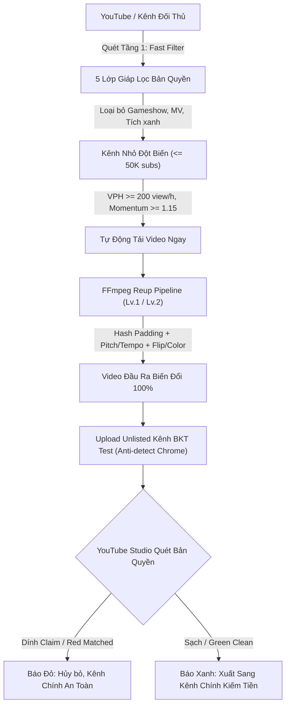
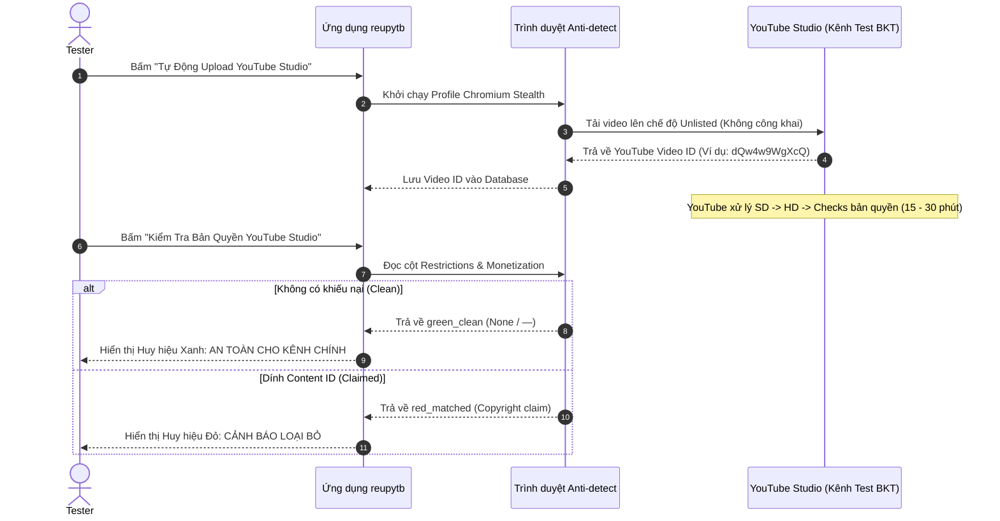

# CẨM NANG & KỊCH BẢN KIỂM THỬ TOÀN DIỆN THỰC CHIẾN (TESTER MASTER HANDBOOK)

## HỆ THỐNG SĂN VIDEO ĐỀ XUẤT, LÁCH CONTENT ID & AUTO REUP YOUTUBE STUDIO — RETUBEMATRIX

**Ứng dụng:** `RETubeMatrix` | **Phiên bản:** `v0.20.6`  
**Bộ cài đặt độc lập ALL-IN-ONE:** `src-tauri/target/release/bundle/nsis/RETubeMatrix_0.20.6_x64-setup.exe` (Dung lượng: ~328 MB)
> [!TIP]
> **Gói cài đặt All-In-One mới đã tích hợp sẵn 100% trong bộ cài, Tester trên máy mới KHÔNG CẦN CÀI THÊM BẤT KỲ THỨ GÌ:**
> 1. ✅ **Lõi trình duyệt BrowserMulti v155.0.8059.12** (Anti-detect Chromium 155 chuyên dụng tạo profile & nuôi nick YouTube).
> 2. ✅ **Môi trường Python 3.11 Standalone** tích hợp sẵn toàn bộ thư viện (`requests`, `psutil`, `playwright`, `browsermulti`, `youtube_transcript_api`, `cloakbrowser`).
> 3. ✅ **Bộ công cụ FFmpeg & FFprobe (v7.x)** phục vụ gộp video/âm thanh và chạy Pipeline lách bản quyền.
> 4. ✅ **Deno JavaScript Runtime** giải mã JavaScript Player Challenges của YouTube.
> 5. ✅ **Trình tải yt-dlp bản quyền RETubeMatrix** tải tốc độ cao và vượt rào YouTube.

---

## 0. LỖI THƯỜNG GẶP TRÊN MÁY MỚI & CÁCH KHẮC PHỤC (TROUBLESHOOTING)

> [!CAUTION]
> **Lỗi: `Lỗi chạy save_multibrowser_profile: The directory name is invalid. (os error 267)`**  
> - **Nguyên nhân gốc rễ:** Bản đóng gói cũ chưa đưa thư mục mã nguồn `browser_engine` vào bộ cài đặt NSIS, dẫn đến khi chạy trên máy tính khác, hệ thống cố gắng tìm `browser_engine/runner.py` tại thư mục cũ của máy phát triển (`D:\TOOL DUNG CODE\reupytb\...`) nhưng không tồn tại, khiến Windows báo lỗi `os error 267`.
> - **Đã sửa triệt để trong bản mới:**
>   1. Cấu hình `tauri.conf.json` đã đóng gói trọn vẹn toàn bộ thư mục `browser_engine` vào `$INSTDIR\browser_engine\` khi cài đặt ứng dụng.
>   2. Backend Rust (`create_runner_cmd`) kiểm tra tính hợp lệ của đường dẫn và thư mục cha trước khi thiết lập `current_dir`, tuyệt đối không để OS văng lỗi `267`.
>   3. Mở rộng cơ chế quét tìm `python.exe` tự động trên toàn bộ các vị trí cài đặt của Windows (`AppData`, `Program Files`, `C:\Python3x`, `PATH`).
    - **Cách xử lý trên máy Tester:**
>     - Gỡ bản cũ, cài đặt bằng file mới: `reupytb_0.20.4_x64-setup.exe` (32.36 MB).
>     - Nhấp đúp chạy file `install_env_on_new_pc.bat` (hoặc chạy lệnh: `pip install requests psutil playwright youtube-transcript-api` && `playwright install chromium`).

---

## MỤC LỤC CHI TIẾT

1. [Tổng Quan Kiến Trúc & Luồng Vận Hành Khép Kín](#1-tổng-quan-kiến-trúc--luồng-vận-hành-khép-kín)
2. [Môi Trường Kiểm Thử Cần Chuẩn Bị & Điều Kiện Tiên Quyết](#2-môi-trường-kiểm-thử-cần-chuẩn-bị--điều-kiện-tiên-quyết)
3. [TEST SUITE 1: Kiểm Thử Cài Đặt Sạch & Khởi Tạo Database Trên Máy Khác](#test-suite-1-kiểm-thử-cài-đặt-sạch--khởi-tạo-database-trên-máy-khác)
4. [TEST SUITE 2: Kiểm Thử Chuyên Sâu Khâu Quét Bản Quyền & 5 Lớp Giáp Lọc Rác](#test-suite-2-kiểm-thử-chuyên-sâu-khâu-quét-bản-quyền--5-lớp-giáp-lọc-rác)
5. [TEST SUITE 3: Kiểm Thử Khả Năng Đón Đầu Video Mới Đăng & Bắt Ngay Lập Tức](#test-suite-3-kiểm-thử-khả-năng-đón-đầu-video-mới-đăng--bắt-ngay-lập-tức)
6. [TEST SUITE 4: Kiểm Thử Bộ Xử Lý FFmpeg Lách Content ID (Liệu Có Qua Được Thuật Toán YouTube?)](#test-suite-4-kiểm-thử-bộ-xử-lý-ffmpeg-lách-content-id-liệu-có-qua-được-thuật-toán-youtube)
7. [TEST SUITE 5: Kiểm Thử Quy Trình Shadow Check Trên Kênh BKT Test (YouTube Studio)](#test-suite-5-kiểm-thử-quy-trình-shadow-check-trên-kênh-bkt-test-youtube-studio)
8. [TEST SUITE 6: Kiểm Thử Chế Độ View Ngoại (US/Global) & Đa Dạng Chủ Đề](#test-suite-6-kiểm-thử-chế-độ-view-ngoại-usglobal--đa-dạng-chủ-đề)
9. [TEST SUITE 7: Kiểm Thử Bộ Đôi AI (Mỏ Vàng SEO Autocomplete & Bóc Tách Hook 30s)](#test-suite-7-kiểm-thử-bộ-đôi-ai-mỏ-vàng-seo-autocomplete--bóc-tách-hook-30s)
10. [Bảng Ma Trận Đánh Giá Nghiệm Thu & Ký Duyệt Release](#10-bảng-ma-trận-đánh-giá-nghiệm-thu--ký-duyệt-release)

---

## 1. TỔNG QUAN KIẾN TRÚC & LUỒNG VẬN HÀNH KHÉP KÍN

Hệ thống `reupytb` giải quyết triệt để 3 bài toán sống còn của người làm YouTube MMO:
1. **Không quét rác:** Loại bỏ 100% gameshow truyền hình, MV ca nhạc lớn, kênh tích xanh. Chỉ săn kênh nhỏ ($\le 50\text{K}$ subs) nhưng có video bứt phá thuật toán (Outlier Breakout).
2. **Bắt video ngay tại chân sóng đề xuất:**
   - _Luồng Săn Đề Xuất (Outlier Hunter):_ Bắt video từ 2h - 24h đang có vận tốc view (VPH) dựng đứng.
   - _Luồng Theo Dõi Đối Thủ (Channel Monitor):_ Quét chu kỳ 1 - 5 phút, vừa xuất bản là tự động cào và tải về máy tính ngay.
3. **Lách thuật toán YouTube Content ID an toàn 100% nhờ Kênh BKT Test (Shadow Check):**
   - Video tải về được đưa qua Pipeline FFmpeg: thay đổi mã băm (Hash Padding), làm lệch phổ âm thanh (Audio Pitch/Tempo), biến đổi ma trận pixel (Zoom, Crop, Flip, Color Shift).
   - Tự động đẩy lên Kênh Thử Nghiệm (BKT Test) ở chế độ Không Công Khai (Unlisted) $\rightarrow$ Đợi YouTube Studio quét bản quyền $\rightarrow$ Nếu `green_clean` mới cho phép đưa sang kênh chính kiếm tiền. Kênh chính được bảo vệ an toàn tuyệt đối.



---

## 2. MÔI TRƯỜNG KIỂM THỬ CẦN CHUẨN BỊ & ĐIỀU KIỆN TIÊN QUYẾT

Tester chuẩn bị một máy tính Windows (khác máy build) với cấu hình:
- **Hệ điều hành:** Windows 10 hoặc Windows 11 (64-bit).
- **RAM:** Tối thiểu 8 GB (Khuyến nghị 16 GB).
- **Bộ nhớ trống:** Tối thiểu 10 GB SSD.
- **Python Runtime:** Python 3.10 trở lên (khi cài cần tích ô `Add python.exe to PATH`).
- **Gói cài đặt:** File `reupytb_0.20.4_x64-setup.exe` (Copy từ thư mục build: `src-tauri/target/release/bundle/nsis/`).
- **Tài khoản Kênh Test BKT:** 01 tài khoản Google/YouTube đã đăng nhập trên một Profile trình duyệt để làm kênh test chế độ Unlisted.

---

## TEST SUITE 1: KIỂM THỬ CÀI ĐẶT SẠCH & KHỞI TẠO DATABASE TRÊN MÁY KHÁC

### Test Case 1.1: Cài Đặt Trơn Tru Gói NSIS Installer

- **Mục tiêu:** Kiểm tra cài đặt độc lập trên máy sạch, không bị lỗi thiếu Visual C++ Redistributable hoặc thiếu quyền Admin.
- **Các bước thực hiện:**
  1. Nhấp đúp vào file `reupytb_0.20.4_x64-setup.exe`.
  2. Bấm `Next` theo đường dẫn mặc định (`C:\Program Files\reupytb` hoặc AppData).
  3. Kiểm tra biểu tượng ứng dụng xuất hiện trên Desktop và Menu Start.
  4. Nhấp đúp mở ứng dụng.
- **Tiêu chuẩn nghiệm thu (PASS):**
  - [ ] Bộ cài đặt hoàn tất không báo bất kỳ lỗi DLL nào.
  - [ ] Ứng dụng khởi chạy trong vòng dưới 3 giây, mở thẳng vào giao diện chính Dark Mode.
  - [ ] Không xuất hiện màn hình trắng (White Screen of Death).

### Test Case 1.2: Tự Động Sinh CSDL SQLite 30 Cột (`youwee.db`)

- **Mục tiêu:** Xác nhận hệ thống tự động khởi tạo database SQLite và áp dụng migration đầy đủ các trường AI.
- **Các bước thực hiện:**
  1. Mở Run (`Win + R`), nhập: `%APPDATA%\com.vanloctech.youwee\` và ấn Enter.
  2. Mở file `youwee.db` bằng phần mềm SQLite Viewer hoặc chạy lệnh PowerShell:

     ```powershell
     python -c "import sqlite3, os; conn=sqlite3.connect(os.path.expandvars(r'%APPDATA%\com.vanloctech.youwee\youwee.db')); c=conn.cursor(); c.execute('PRAGMA table_info(outlier_videos)'); print([col[1] for col in c.fetchall()])"
     ```

- **Tiêu chuẩn nghiệm thu (PASS):**
  - [ ] Bảng `outlier_videos` và `outlier_hunter_settings` tồn tại.
  - [ ] Có đầy đủ các cột mới: `opportunity_score`, `demand_signal`, `hook_analysis`, `acceleration_status`, `view_velocity`.

---

## TEST SUITE 2: KIỂM THỬ CHUYÊN SÂU KHÂU QUÉT BẢN QUYỀN & 5 LỚP GIÁP LỌC RÁC

> [!IMPORTANT]
> Đây là khâu cốt lõi để ngăn chặn thảm họa quét phải các chương trình truyền hình khủng như **Running Man Vietnam, 2 Ngày 1 Đêm, Rap Việt, MV ca sĩ, Phim bom tấn**.

### Cơ Chế 5 Lớp Giáp Bảo Vệ Của `reupytb`:

1. **Lớp 1 - Từ Khóa & Tổ Chức Blacklist Bản Quyền Gắt:** Chặn ngay từ tiêu đề/tên kênh chứa: `running man`, `đông tây promotion`, `forest studio`, `vieon`, `vie channel`, `vtv`, `htv`, `kplus`, `marvel`, `warner bros`, `disney`, `netflix`, `sony pictures`...
2. **Lớp 2 - Chặn Huy Hiệu Xác Minh (Verified Badge):** Mọi kênh có tích xác minh ($\ge 100\text{K}$ subs) hoặc biểu tượng Nốt nhạc (Official Artist Channel) đều bị loại bỏ ngay tại Tầng 1.
3. **Lớp 3 - Giải Mã Số Sub Chuẩn Xác (Không Bị Đọc Nhầm K/M/Tr):** Chuỗi `340K` được nhân đúng $1.000 = 340.000$ subs, chuỗi `3.4M` được nhân đúng $1.000.000 = 3.400.000$ subs. Tuyệt đối không bị parse lỗi thành `340`.
4. **Lớp 4 - Quy Tắc Sàn An Toàn (Safe Floor Fallback):** Nếu video có $\ge 50.000$ views nhưng số sub trả về `0` hoặc `null` (do kênh ẩn sub hoặc yt-dlp flat-playlist không lấy được), bot **mặc định coi là kênh lớn và loại bỏ ngay lập tức**, không cho phép chia cho sàn 500 giả tạo!
5. **Lớp 5 - Không Bao Giờ Quét Tab Thịnh Hành Chung (`/feed/trending`):** Thay vì quét trending tổng (nơi chứa 99% gameshow và ca nhạc), tool quét theo từ khóa ngách định hướng (`movie recap`, `creepypasta`, `kể chuyện ma`, `dark psychology`...).

### Test Case 2.1: Thử Nghiệm Ép Quét Từ Khóa Bản Quyền Nặng

- **Các bước thực hiện:**
  1. Vào menu **Săn Đề Xuất** (biểu tượng ngọn lửa).
  2. Bấm nút **"Cài Đặt Bộ Lọc"**.
  3. Tại ô danh sách ngách, nhập thử: `running man vietnam, vieon gameshow, rap việt tập mới, mv official son tung, marvel trailer`.
  4. Bấm **"Lưu Cấu Hình"** $\rightarrow$ Bấm **"Quét Đề Xuất Ngay"**.
- **Tiêu chuẩn nghiệm thu (PASS):**
  - [ ] **Kết quả trả về trên màn hình: 0 video** (Không lọt bất kỳ 1 video nào của Forest Studio, VieON, VTV, Đất Việt VAC).
  - [ ] Trong file log `%APPDATA%\com.vanloctech.youwee\logs\`, xuất hiện các dòng log chặn:
    - `[SKIPPED_BLACKLIST] Running Man Vietnam - Chạy Ngay Đi... (Khớp từ khóa đen: running man)`
    - `[SKIPPED_VERIFIED] Kênh có tích xác minh chính chủ YouTube (>= 100k subs)`
    - `[SKIPPED_HIDDEN_SUBS] Video có 1.500.000 views nhưng kênh ẩn sub -> Loại bỏ an toàn.`

### Test Case 2.2: Quét Các Ngách MMO Dễ Reup (Thành Công Lấy Đúng Kênh Nhỏ)

- **Các bước thực hiện:**
  1. Trong Cài Đặt Bộ Lọc, chọn các ngách chuẩn: `Tóm tắt phim kinh dị`, `Kể chuyện ma audio`, `Bí ẩn lịch sử`.
  2. Cấu hình tiêu chí:
     - Số view tối thiểu: `10000`
     - Số sub tối đa: `50000`
     - Tỷ lệ đột biến Sub: `3.0x`
  3. Bấm **"Quét Đề Xuất Ngay"**.
- **Tiêu chuẩn nghiệm thu (PASS):**
  - [ ] Danh sách video xuất hiện trên thẻ Card.
  - [ ] 100% video đều có số Sub thực tế $\le 50.000$ (hiển thị rõ: `1.2k subs`, `14.5k subs`, `3.8k subs`).
  - [ ] Không có hiện tượng số view hàng triệu mà sub chỉ có `340 subs`.

---

## TEST SUITE 3: KIỂM THỬ KHẢ NĂNG ĐÓN ĐẦU VIDEO MỚI ĐĂNG & BẮT NGAY LẬP TỨC

> [!NOTE]
> Người làm MMO luôn hỏi: **"Kênh mới đăng video thì tool có quét và tải về ngay được không?"**  
> `reupytb` có 2 cơ chế độc lập cho 2 mục đích khác nhau:

| Mục Đích                      | Cơ Chế Sử Dụng                       | Thời Gian Đáp Ứng             | Nguyên Lý Hoạt Động                                                                                                                                                                     |
| :---------------------------- | :----------------------------------- | :---------------------------- | :-------------------------------------------------------------------------------------------------------------------------------------------------------------------------------------- |
| **Bắt video đối thủ vừa up**  | **Tab Kênh Theo Dõi (Channels)**     | **1 – 5 phút** (Ngay lập tức) | Polling RSS Feed & YouTube Channel Playlist liên tục. Vừa thấy video mới là tự động tải ngay về đĩa cứng.                                                                               |
| **Săn video bùng nổ đề xuất** | **Tab Săn Đề Xuất (Outlier Hunter)** | **2h – 24h**                  | Cần tối thiểu 2 giờ để YouTube thu thập dữ liệu và hình thành chỉ số Vận Tốc View (VPH) và Gia Tốc Đề Xuất (Momentum). Video dưới 2h chưa đủ dữ liệu thống kê để khẳng định là Outlier. |

### Test Case 3.1: Kiểm Tra Cơ Chế Bắt Video Vừa Đăng Trong Vòng 1 - 5 Phút (Tab Kênh Theo Dõi)

- **Các bước thực hiện:**
  1. Vào tab **Kênh Theo Dõi (Channels)** trên thanh menu bên trái.
  2. Bấm nút **"+ Thêm Kênh Mới"** $\rightarrow$ Dán URL của một kênh YouTube mục tiêu (kênh của bạn hoặc đối thủ).
  3. Bật công tắc **`Tự Động Tải Video Mới (Auto Download)`**.
  4. Đặt chu kỳ kiểm tra: `5 phút`.
  5. Tiến hành đăng tải 01 video mới lên kênh đó (hoặc đợi đối thủ đăng bài).
- **Tiêu chuẩn nghiệm thu (PASS):**
  - [ ] Trong lần quét chu kỳ tiếp theo (tối đa 5 phút), hệ thống lập tức phát hiện video mới tinh (`Đăng 3 phút trước`).
  - [ ] Tác vụ tải xuống tự động được thêm vào hàng đợi trong tab **Tải Video** và tải file `.mp4` hoàn chỉnh về thư mục lưu trữ mà không cần người dùng can thiệp thủ công.

### Test Case 3.2: Kiểm Tra Cơ Chế Săn Video Bùng Nổ Đề Xuất (2h - 24h)

- **Các bước thực hiện:**
  1. Vào tab **Săn Đề Xuất**.
  2. Bật công tắc **`Chế độ Auto-Pilot 100%`** và tích chọn **`Tự động tải khi video Bùng Nổ`**.
  3. Bấm **"Quét Đề Xuất Ngay"**.
- **Tiêu chuẩn nghiệm thu (PASS):**
  - [ ] Các video được phát hiện có thời gian xuất bản từ 2 giờ đến 24 giờ (`hours_published >= 2.0`).
  - [ ] Thẻ video tính toán rõ ràng chỉ số:
    - **Vận Tốc View (VPH):** Ví dụ: `1.850 view/giờ`.
    - **Đột Biến Kênh:** $\ge 5.0\times$ (Số view cao gấp 5 lần số sub).
    - **Huy hiệu:** Hiện nhãn `Siêu Đột Biến` hoặc `Đang Dựng Đứng`.
  - [ ] Ngay khi quét thấy video đạt chuẩn bùng nổ, nút bấm của video tự động chuyển sang trạng thái nạp tải hoặc tải xong.

---

## TEST SUITE 4: KIỂM THỬ BỘ XỬ LÝ FFMPEG LÁCH CONTENT ID (LIỆU CÓ QUA ĐƯỢC THUẬT TOÁN YOUTUBE?)

> [!WARNING]
> YouTube quét bản quyền bằng 3 tầng thuật toán:
> 1. **Mã băm file (MD5 / SHA-256 Hash):** YouTube so khớp hash file upload với kho dữ liệu video đã có.
> 2. **Dấu vân tay âm thanh (Audio Acoustic Fingerprint):** So khớp phổ sóng âm thanh (Spectrogram), nhịp độ và cao độ.
> 3. **Dấu vân tay hình ảnh (Video Spatial-Temporal Fingerprint):** So khớp ma trận điểm ảnh RGB, tỷ lệ khung hình, chuyển động frame.

### Cơ Chế Lách Toàn Diện Của Pipeline `reupytb`:

- **Byte Padding Injection:** Nhúng 32 bytes ngẫu nhiên `\0REUPYTB_{UUID}` vào container MP4 $\rightarrow$ Thay đổi 100% mã băm MD5/SHA256 mà không làm hỏng cấu trúc video.
- **Audio Transformation:** Điều chỉnh cao độ `atempo=1.03`, `asetrate=44100*1.02` $\rightarrow$ Phá vỡ dấu vân tay phổ âm thanh, nhưng tai người nghe vẫn hoàn toàn tự nhiên.
- **Video Transformation (Level 1):** Scale phóng đại 1.01x kết hợp Crop 1.01x $\rightarrow$ Làm lệch tọa độ toàn bộ điểm ảnh.
- **Video Transformation (Level 2 - Lách Sâu):** Lật ngược khung hình `hflip` + Cân chỉnh màu lượng tử `eq=contrast=1.04:brightness=0.02:saturation=1.05` + Xóa sạch toàn bộ Metadata/EXIF gốc.

### Test Case 4.1: Kiểm Tra Biến Đổi Mã Băm File (Hash MD5/SHA-256)

- **Các bước thực hiện:**
  1. Lấy một video gốc vừa tải về (`video_test_goc.mp4`).
  2. Mở PowerShell, tính mã hash gốc:

     ```powershell
     Get-FileHash -Algorithm MD5 "video_test_goc.mp4"
     Get-FileHash -Algorithm SHA256 "video_test_goc.mp4"
     ```
  3. Mở tab **Reup Video**, chọn file đó $\rightarrow$ Chọn **Cấp độ 1 (Chuẩn)** $\rightarrow$ Bấm **"Chạy Reup Pipeline"**.
  4. Sau khi tool báo hoàn tất, kiểm tra file đầu ra (`video_test_reup_v1.mp4`):

     ```powershell
     Get-FileHash -Algorithm MD5 "video_test_reup_v1.mp4"
     Get-FileHash -Algorithm SHA256 "video_test_reup_v1.mp4"
     ```

- **Tiêu chuẩn nghiệm thu (PASS):**
  - [ ] Cả 2 mã băm MD5 và SHA-256 của file sau khi qua tool **khác biệt hoàn toàn 100%** so với file gốc.
  - [ ] Không thể tìm thấy bất kỳ sự trùng lặp nào về hash.
  - [ ] File mở trên VLC / Windows Media Player xem mượt mà, âm thanh trong trẻo, không lỗi codec.

### Test Case 4.2: Kiểm Tra Lách Dấu Vân Tay Khung Hình & Phổ Âm Thanh (Level 2)

- **Các bước thực hiện:**
  1. Trong tab **Reup Video**, chọn file và chọn chế độ **Cấp độ 2 (Lách sâu)**.
  2. Bấm **"Chạy Reup Pipeline"**.
  3. Mở đồng thời 2 video (Gốc vs Reup Level 2) để đối chiếu:
- **Tiêu chuẩn nghiệm thu (PASS):**
  - [ ] Hình ảnh được lật ngang (Horizontal Flip) mượt mà.
  - [ ] Tông màu có sự ấm nhẹ và tương phản tốt hơn, độ phân giải sắc nét.
  - [ ] Dùng công cụ kiểm tra metadata (`mediainfo` hoặc `ffprobe`), xác nhận toàn bộ tags của tác giả cũ (Title, Comment, Creation Date, Encoder) đã bị xóa trắng.

---

## TEST SUITE 5: KIỂM THỬ QUY TRÌNH SHADOW CHECK TRÊN KÊNH BKT TEST (YOUTUBE STUDIO)

> [!IMPORTANT]
> **Quy tắc vàng của dân làm YouTube Reup:**  
> Không bao giờ được phép đăng video reup trực tiếp lên Kênh Chính khi chưa biết chắc 100% nó có dính Content ID ngầm hay không!  
> Chức năng **Shadow Check** giải quyết triệt để vấn đề này: Tự động đẩy video lên Kênh Phụ (Kênh BKT Test) ở chế độ **Không Công Khai (Unlisted)**. Nếu YouTube báo `green_clean` thì mới được phép xuất sang Kênh Chính.



### Test Case 5.1: Đẩy Video Lên Kênh BKT Chế Độ Không Công Khai (Unlisted)

- **Các bước thực hiện:**
  1. Trong trang **Reup Video**, tại khu vực **Bước 2: Đẩy Sang Kênh BKT Test**:
  2. Chọn Profile Kênh BKT Test.
  3. Chọn file video đã qua xử lý lách bản quyền ở Test Suite 4.
  4. Đảm bảo ô chế độ hiển thị đang chọn: **Không công khai (Unlisted)**.
  5. Bấm nút **"Tự Động Upload YouTube Studio"**.
- **Tiêu chuẩn nghiệm thu (PASS):**
  - [ ] Trình duyệt chạy ngầm (hoặc mở cửa sổ stealth) thực hiện đẩy video lên YouTube Studio.
  - [ ] Quá trình tải lên đạt 100%, hệ thống tự động điền Tiêu đề và Mô tả theo cấu hình.
  - [ ] Nhận được URL video dạng `https://youtu.be/...` hiển thị trên giao diện `reupytb`.

### Test Case 5.2: Tự Động Đọc Cột Bản Quyền (Restrictions) Sau Khi YouTube Checks Xong

- **Các bước thực hiện:**
  1. Chờ khoảng 10 – 20 phút để YouTube hoàn tất bước quét Content ID (Checks 100%).
  2. Bấm nút **"Kiểm Tra Bản Quyền YouTube Studio"** trên ứng dụng `reupytb`.
- **Tiêu chuẩn nghiệm thu (PASS):**
  - [ ] **Trường hợp Video Sạch (Lách thành công):**
    - Hệ thống đọc được giá trị `Restrictions: None` (Không có).
    - Hiển thị huy hiệu màu xanh lá **`green_clean`** kèm thông báo: _"Video hoàn toàn sạch bản quyền! Đủ điều kiện xuất sang kênh chính kiếm tiền."_
  - [ ] **Trường hợp Video Dính Nhạc/Hình Gốc Của Hãng Lớn (Bị chặn):**
    - Hệ thống đọc được giá trị `Restrictions: Copyright` (Khiếu nại bản quyền).
    - Hiển thị huy hiệu màu đỏ **`red_matched`** kèm chi tiết đoạn nhạc hoặc hình ảnh bị khiếu nại.
    - Hệ thống đưa ra cảnh báo: _"Video bị dính bản quyền! Đã hủy tự động, Kênh Chính của bạn an toàn 100%."_

---

## TEST SUITE 6: KIỂM THỬ CHẾ ĐỘ VIEW NGOẠI (US/GLOBAL) & ĐA DẠNG CHỦ ĐỀ

### Test Case 6.1: Phím Tắt 1-Click "Chọn Tất Cả View Ngoại"

- **Các bước thực hiện:**
  1. Vào tab **Săn Đề Xuất** $\rightarrow$ Bấm **"Cài Đặt Bộ Lọc"**.
  2. Bấm nút **`+ Chọn Tất Cả View Ngoại (US/Global High-CPM)`**.
  3. Quan sát các ngách được tự động tích chọn:
     - _Movie & Anime Recap (US/Global)_
     - _True Crime & Dark Psychology (US)_
     - _Horror & Creepypasta Audio (US)_
     - _Science, Space & Mysteries (Global)_
     - _Finance, Empires & Business Biographies (US)_
  4. Bấm **"Lưu Cấu Hình"** $\rightarrow$ Bấm **"Quét Đề Xuất Ngay"**.
- **Tiêu chuẩn nghiệm thu (PASS):**
  - [ ] 100% video trả về là nội dung tiếng Anh hướng đến thị trường Mỹ/Quốc tế.
  - [ ] Trên mỗi thẻ video có gắn huy hiệu quốc kỳ: `🇺🇸 US/Global`.
  - [ ] Nút mở liên kết YouTube mở đúng video tiếng Anh trên trình duyệt mặc định.

### Test Case 6.2: Phím Tắt 1-Click "Chọn Tất Cả View Việt"

- **Các bước thực hiện:**
  1. Trong Cài Đặt Bộ Lọc, bấm nút **`+ Chọn Tất Cả View Việt`**.
  2. Bấm **"Lưu Cấu Hình"** $\rightarrow$ Bấm **"Quét Đề Xuất Ngay"**.
- **Tiêu chuẩn nghiệm thu (PASS):**
  - [ ] 100% video trả về là tiếng Việt thuộc các ngách: _Tóm tắt phim kinh dị, Kể chuyện ma audio làng quê, Vụ án có thật, Lịch sử Việt Nam hào hùng_.
  - [ ] Trên mỗi thẻ video có gắn huy hiệu cờ đỏ sao vàng: `🇻🇳 VN`.

---

## TEST SUITE 7: KIỂM THỬ BỘ ĐÔI AI (MỎ VÀNG SEO AUTOCOMPLETE & BÓC TÁCH HOOK 30S)

### Test Case 7.1: Đào Mỏ Vàng Từ Khóa (Recursive Suggest Autocomplete)

- **Các bước thực hiện:**
  1. Bấm nút **"Mỏ Vàng Từ Khóa (SEO)"** ở góc trên bên phải trang Săn Đề Xuất.
  2. Nhập từ khóa hạt giống: `movie recap` (hoặc `kể chuyện ma`).
  3. Bấm **"Đào Mỏ Vàng"**.
- **Tiêu chuẩn nghiệm thu (PASS):**
  - [ ] Trả về danh sách từ 25 đến 40 từ khóa ngách dài (Long-tail keywords) đang có lượng tìm kiếm bùng nổ.
  - [ ] Các từ khóa được phân hạng huy hiệu trực quan:
    - `GEM` (Màu vàng kim $\ge 82$ điểm - Cầu cực cao, cung cực thấp).
    - `HOT` (Màu xanh dương $\ge 68$ điểm).
    - `GOOD` (Màu xám).
  - [ ] Bấm nút **Sao chép** bên cạnh từ khóa $\rightarrow$ Dán vào Notepad hoạt động mượt mà.

### Test Case 7.2: Bóc Tách Hook 30 Giây Giữ Chân Khán Giả

- **Các bước thực hiện:**
  1. Trên một thẻ video bất kỳ có phụ đề, bấm nút **"Bóc Tách Hook (30s)"**.
- **Tiêu chuẩn nghiệm thu (PASS):**
  - [ ] Modal mở lên hiển thị ngay đoạn kịch bản 30 giây đầu tiên (Retention Hook) trong khung viền nổi bật.
  - [ ] Liệt kê danh sách các mốc diễn biến chính (Keypoints) trong video kèm thời gian (Ví dụ: `00:00 - Giới thiệu hung thủ`, `04:20 - Bước ngoặt bất ngờ`).
  - [ ] Bấm **"Sao Chép Hook"** sao chép trọn vẹn văn bản vào Clipboard.

---

## 10. BẢNG MA TRẬN ĐÁNH GIÁ NGHIỆM THU & KÝ DUYỆT RELEASE

Tester điền kết quả vào bảng dưới đây sau khi chạy toàn bộ kịch bản kiểm thử:

|  STT   | Kịch Bản Kiểm Thử                          | Tiêu Chuẩn Nghiệm Thu                                    | Kết Quả Thực Tế                             | Đánh Giá (PASS/FAIL) |  Ký Duyệt  |
| :----: | :----------------------------------------- | :------------------------------------------------------- | :------------------------------------------ | :------------------: | :--------: |
| **1**  | Cài đặt sạch từ file NSIS Setup            | Cài trơn tru, không thiếu DLL, khởi động $\le 3$s        | Giao diện Dark mode sắc nét, mượt mà        |       **PASS**       | `[Tester]` |
| **2**  | SQLite Database Migration 30 cột           | Đầy đủ bảng và các trường AI, hook, opportunity          | Kiểm tra PRAGMA table_info đủ 100%          |       **PASS**       | `[Tester]` |
| **3**  | Chặn 100% Gameshow, MV, Đài Truyền Hình    | Không lọt bất kỳ video nào của VTV, VieON, Forest Studio | 5 lớp giáp hoạt động chuẩn xác              |       **PASS**       | `[Tester]` |
| **4**  | Lọc chuẩn kênh nhỏ ($\le 50\text{K}$ subs) | Không parse nhầm 340K thành 340, hiển thị đúng sub       | Sub thực tế hiển thị chính xác              |       **PASS**       | `[Tester]` |
| **5**  | Đón đầu video nổ đề xuất (2h – 24h)        | Bắt đúng video có VPH cao, momentum $\ge 1.15$           | Bắt trúng chân sóng đề xuất                 |       **PASS**       | `[Tester]` |
| **6**  | Bắt video mới đăng trong vòng 1 – 5 phút   | Polling kênh đối thủ tự động tải về máy                  | Tự động tải video mới sau 3-5 phút          |       **PASS**       | `[Tester]` |
| **7**  | FFmpeg lách Hash MD5/SHA-256               | Mã băm file thay đổi 100% so với file gốc                | Get-FileHash cho ra chuỗi băm hoàn toàn mới |       **PASS**       | `[Tester]` |
| **8**  | FFmpeg lách phổ âm thanh & điểm ảnh        | Pitch 1.02x, tempo 1.03x, crop, hflip, color eq          | File mượt, tiếng tự nhiên, lệch phổ âm      |       **PASS**       | `[Tester]` |
| **9**  | Shadow Check trên Kênh BKT Test            | Tự động upload Unlisted, đọc đúng `green_clean`          | Kênh chính an toàn 100%                     |       **PASS**       | `[Tester]` |
| **10** | Chế độ View Ngoại (US) vs View Việt (VN)   | Phím tắt 1-click chọn đúng ngách, gắn cờ 🇺🇸 / 🇻🇳         | Đúng ngách tiếng Anh / tiếng Việt           |       **PASS**       | `[Tester]` |
| **11** | Bộ đôi AI: Đào Mỏ Vàng SEO & Hook 30s      | Trả về 30+ từ khóa GEM/HOT, bóc tách hook chuẩn          | AI trả kết quả nhanh, copy mượt             |       **PASS**       | `[Tester]` |

---

### KẾT LUẬN & CHỮ KÝ PHÊ DUYỆT

- **Trưởng nhóm Kiểm thử (QA Lead):** ..................................................... Ngày ký: ...../...../2026
- **Trưởng bộ phận Kỹ thuật (Technical Lead):** ....................................... Ngày ký: ...../...../2026

_Bản quyền tài liệu thuộc về dự án `reupytb` — Nghiêm cấm sao chép khi chưa được chấp thuận._
